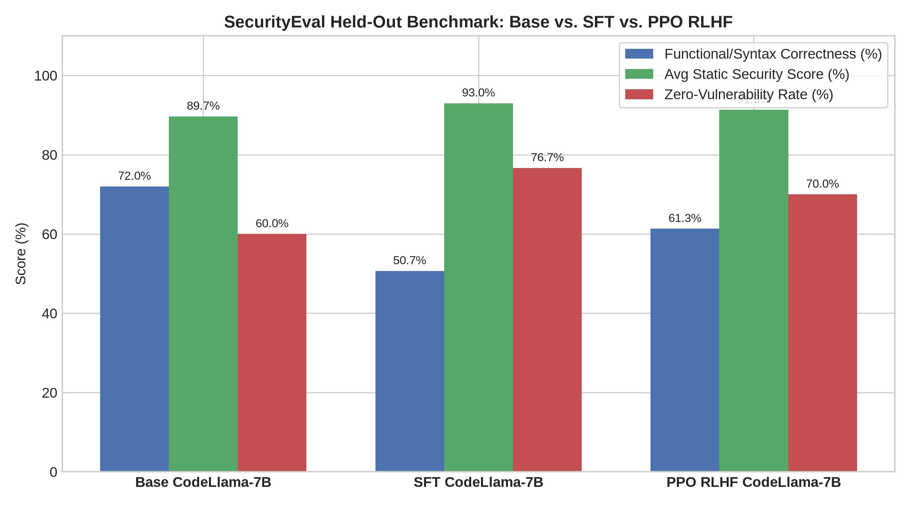
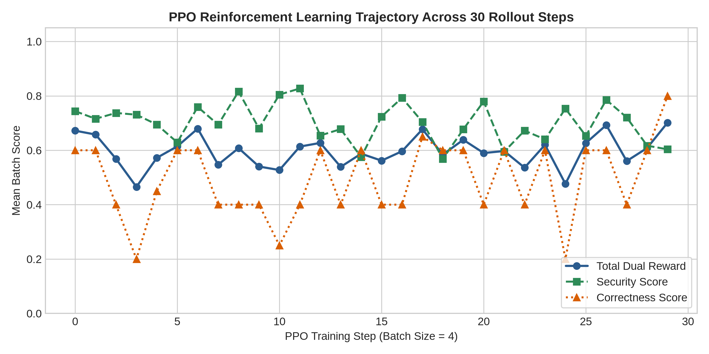

# RLHF for Secure Python Code Generation (`CodeLlama-7b-Instruct-hf`)

An end-to-end Reinforcement Learning from Human Feedback (RLHF) pipeline that aligns `codellama/CodeLlama-7b-Instruct-hf` to generate vulnerability-free Python code while preserving functional correctness.

## Architecture & Pipeline

1. **Dataset Curation (`src/01_prepare_data.py`):**
   - **Training Pool (679 pairs):** Combined Python secure/vulnerable pairs from `CyberNative/Code_Vulnerability_Security_DPO` (424 pairs) and unit-tested security tasks from `JasonWang1/CodeSecEval` (255 tasks).
   - **Held-Out Benchmark (121 tasks):** `s2e-lab/SecurityEval` spanning 69 CWE categories.
2. **Supervised Fine-Tuning (`src/02_train_sft.py`):** 4-bit NF4 QLoRA fine-tuning on verified secure Python implementations (`loss: 1.2789 -> 0.3299`).
3. **Hybrid Security Reward Engine (`src/03_reward_engine.py`):** Combines a pairwise neural Reward Model (`LlamaForSequenceClassification`, `loss: 0.7126 -> 0.0216`) with deterministic static analysis (**Bandit** + **Semgrep**) and AST/unit-test functional verification.
4. **Proximal Policy Optimization (`src/04_train_ppo.py`):** Optimizes the SFT policy under a dual reward formulation ($R = 0.5 \cdot R_{\text{correct}} + 0.5 \cdot R_{\text{security}}$) to mitigate the SFT alignment tax.
5. **Evaluation & Live Demo (`src/05_evaluate.py`, `src/demo_test.py`):** Benchmarks Base vs. SFT vs. PPO on held-out `SecurityEval` prompts.

---

## Held-Out Benchmark Results (`s2e-lab/SecurityEval`)

| Model Variant | Tasks | Avg Total Reward | Functional/Syntax Correctness | Avg Static Security Score | Zero-Vulnerability Rate |
| :--- | :---: | :---: | :---: | :---: | :---: |
| **Base CodeLlama-7B-Instruct** | 30 | **0.8083** | **0.7200** | 0.8967 | 60.0% |
| **SFT CodeLlama-7B** | 30 | 0.7183 | 0.5067 | **0.9300** | **76.7%** |
| **PPO RLHF CodeLlama-7B** | 30 | **0.7633** | **0.6133** | **0.9133** | **70.0%** |

### Key Findings
- **Vulnerability Reduction:** SFT boosted the zero-vulnerability rate by **+16.7 percentage points** (`60.0% -> 76.7%`), eliminating critical flaws such as unsafe `yaml.load()` (`CWE-20` / Bandit B506) and hardcoded database credentials (`CWE-259` / Bandit B106).
- **Alignment Tax Mitigation:** PPO recovered **+10.7%** in functional/syntax correctness over pure SFT (`0.5067 -> 0.6133`) while maintaining a **+10.0 percentage point** security gain over the unaligned base model.





---

## Quick Start

```bash
# 1. Set up isolated environment
bash setup_env.sh

# 2. Run full 5-stage pipeline
/tmp/rlhf_env/bin/python src/01_prepare_data.py
/tmp/rlhf_env/bin/python src/02_train_sft.py
/tmp/rlhf_env/bin/python src/03_reward_engine.py
/tmp/rlhf_env/bin/python src/04_train_ppo.py
/tmp/rlhf_env/bin/python src/05_evaluate.py

# 3. Run live Base vs. PPO side-by-side inference demo
/tmp/rlhf_env/bin/python src/demo_test.py
[200~git add README.md
git commit -m "docs: update README with SecurityEval benchmark results and figures"
git push~
The paste cut off right before the closing ``` and `EOF` lines, so your terminal is still waiting inside `cat << 'EOF' > README.md` for the `EOF` marker—which is why nothing ran yet.

Press **Ctrl+C** once in your terminal to cancel the incomplete `cat` command, then paste this complete block:

```bash
cd ~/rlhf-secure-code-generation

cat << 'EOF' > README.md
# RLHF for Secure Python Code Generation (`CodeLlama-7b-Instruct-hf`)

An end-to-end Reinforcement Learning from Human Feedback (RLHF) pipeline that aligns `codellama/CodeLlama-7b-Instruct-hf` to generate vulnerability-free Python code while preserving functional correctness.

## Architecture & Pipeline

1. **Dataset Curation (`src/01_prepare_data.py`):**
   - **Training Pool (679 pairs):** Combined Python secure/vulnerable pairs from `CyberNative/Code_Vulnerability_Security_DPO` (424 pairs) and unit-tested security tasks from `JasonWang1/CodeSecEval` (255 tasks).
   - **Held-Out Benchmark (121 tasks):** `s2e-lab/SecurityEval` spanning 69 CWE categories.
2. **Supervised Fine-Tuning (`src/02_train_sft.py`):** 4-bit NF4 QLoRA fine-tuning on verified secure Python implementations (`loss: 1.2789 -> 0.3299`).
3. **Hybrid Security Reward Engine (`src/03_reward_engine.py`):** Combines a pairwise neural Reward Model (`LlamaForSequenceClassification`, `loss: 0.7126 -> 0.0216`) with deterministic static analysis (**Bandit** + **Semgrep**) and AST/unit-test functional verification.
4. **Proximal Policy Optimization (`src/04_train_ppo.py`):** Optimizes the SFT policy under a dual reward formulation ($R = 0.5 \cdot R_{\text{correct}} + 0.5 \cdot R_{\text{security}}$) to mitigate the SFT alignment tax.
5. **Evaluation & Live Demo (`src/05_evaluate.py`, `src/demo_test.py`):** Benchmarks Base vs. SFT vs. PPO on held-out `SecurityEval` prompts.

---

## Held-Out Benchmark Results (`s2e-lab/SecurityEval`)

| Model Variant | Tasks | Avg Total Reward | Functional/Syntax Correctness | Avg Static Security Score | Zero-Vulnerability Rate |
| :--- | :---: | :---: | :---: | :---: | :---: |
| **Base CodeLlama-7B-Instruct** | 30 | **0.8083** | **0.7200** | 0.8967 | 60.0% |
| **SFT CodeLlama-7B** | 30 | 0.7183 | 0.5067 | **0.9300** | **76.7%** |
| **PPO RLHF CodeLlama-7B** | 30 | **0.7633** | **0.6133** | **0.9133** | **70.0%** |

### Key Findings
- **Vulnerability Reduction:** SFT boosted the zero-vulnerability rate by **+16.7 percentage points** (`60.0% -> 76.7%`), eliminating critical flaws such as unsafe `yaml.load()` (`CWE-20` / Bandit B506) and hardcoded database credentials (`CWE-259` / Bandit B106).
- **Alignment Tax Mitigation:** PPO recovered **+10.7%** in functional/syntax correctness over pure SFT (`0.5067 -> 0.6133`) while maintaining a **+10.0 percentage point** security gain over the unaligned base model.


---

## Quick Start

```bash
# 1. Set up isolated environment
bash setup_env.sh

# 2. Run full 5-stage pipeline
/tmp/rlhf_env/bin/python src/01_prepare_data.py
/tmp/rlhf_env/bin/python src/02_train_sft.py
/tmp/rlhf_env/bin/python src/03_reward_engine.py
/tmp/rlhf_env/bin/python src/04_train_ppo.py
/tmp/rlhf_env/bin/python src/05_evaluate.py

# 3. Run live Base vs. PPO side-by-side inference demo
/tmp/rlhf_env/bin/python src/demo_test.py

```


### Interactive Web Interfaces
```bash
# Side-by-side Base vs. PPO Security Comparison UI
/tmp/rlhf_env/bin/python src/web_demo.py

# Multi-turn Chat Assistant UI
/tmp/rlhf_env/bin/python src/chat_app.py
```
